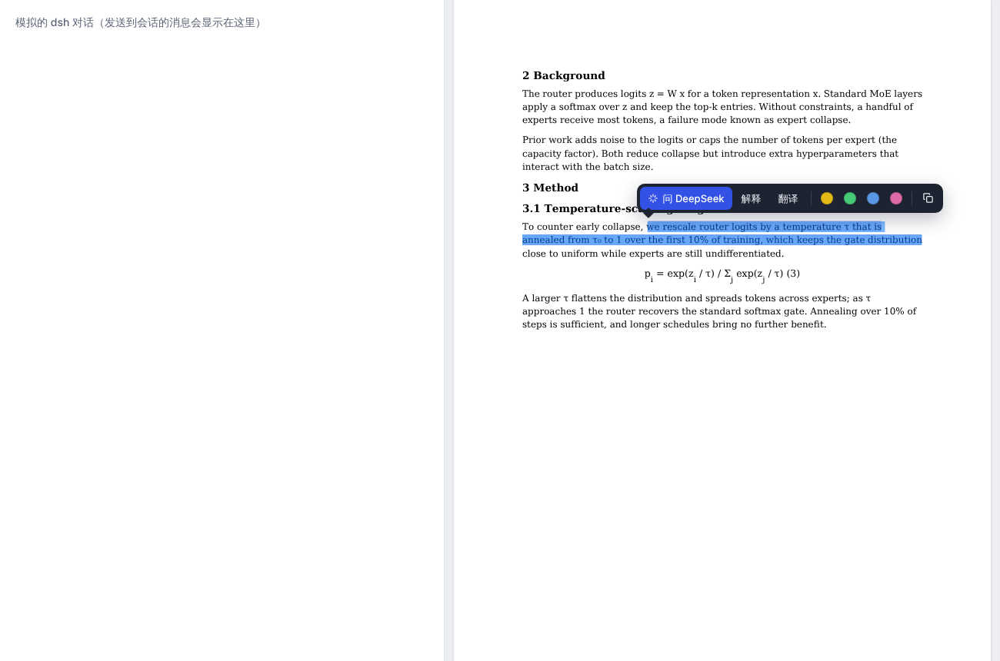
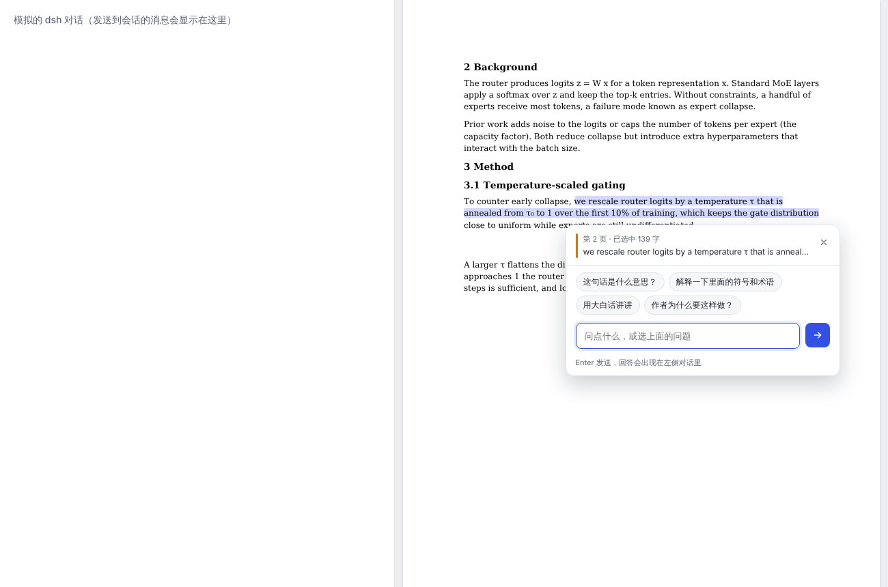

# dsh-paper-reader

[DeepSeek Harness (dsh)](https://github.com/deepseek-ai/deepseek-harness) 的论文伴读插件：在右侧栏打开 PDF，选中一句话，直接问 DeepSeek。

- **划词工具条**：选中文字后弹出「问 DeepSeek / 解释 / 翻译」、四种高亮颜色和复制。点已有的高亮可以换颜色或删除。
- **提问卡片**：引用选中的原文和页码，带几个常用问题，也可以自己输入，Enter 发送。
- **回答在 dsh 原生对话里**：问题直接发进当前会话，用的是你在 dsh 里配好的模型，不用另填 API Key。
- **自动附上上下文**：发送时会附上选中内容所在的段落、所在章节，以及选中的符号或缩写（比如 τ、MoE）在文中第一次出现的位置，模型一轮就能答，不用再自己去搜。
- **布局用 dsh 自带的**：PDF 是右侧栏的一个标签页，可以拖动、分屏、浮动；预览顶部的下拉框可以随时切回 dsh 默认的 PDF 预览。




## 安装

```bash
dsh plugin --profile web add @zbochuan/dsh-paper-reader@latest
```

（还没有发布到 npm。开发时可以用本地路径：`dsh plugin --profile web add /path/to/dsh-paper-reader`。）

装好后在 dsh 的右侧栏文件树里打开任意 PDF 即可。

## 工作方式

| 部分 | 文件 | 作用 |
|---|---|---|
| 宿主端 | `src/index.js`、`src/routes.js` | 在 dsh 的 web server 上挂 `/paper-reader`：提供阅读器脚本和 pdf.js；`POST /api/ask` 用 `sessionController.prompt` 把问题发进当前会话 |
| 浏览器端 | `lib/client.js` | 通过 `ctx.documentPreviews` 注册一个优先级为 `extension` 的 PDF 渲染器，挂到 `sidebar.right.tab.document` 插槽 |
| 阅读器 | `reader/viewer.js`、`reader/viewer.css` | pdf.js 渲染 + 可选中的文字层、高亮、划词工具条、提问卡片 |
| 上下文 | `reader/context.js` | 找段落、章节标题、符号首次出现的位置 |
| 消息格式 | `src/prompt.js` | 把引用、问题和上下文拼成发给会话的一条消息 |

高亮目前存在浏览器的 localStorage 里，按文件地址区分。

## 本地开发

不需要装 dsh，也能在浏览器里调阅读器：

```bash
npm install
python3 scripts/make-sample-pdf.py .data/sample.pdf   # 需要 reportlab
npm run dev                                           # http://localhost:4317/
npm test
```

本地预览页左边模拟 dsh 对话，显示实际会发进会话的消息。

## 已知限制

- 对话固定在 dsh 的中间一栏，不能和 PDF 互换位置。
- 只有在会话工作区里打开的 PDF 才能发送问题（地址形如 `dsh-resource://file/session/...`）。
- 扫描版 PDF 没有文字层，选不了字。
- 浏览器端接口（`documentPreviews`、`sidebar.right.tab.document`）是照 dsh 0.2.x 的客户端包写的，还没有在真实的 dsh 桌面端里跑过。

## License

MIT
